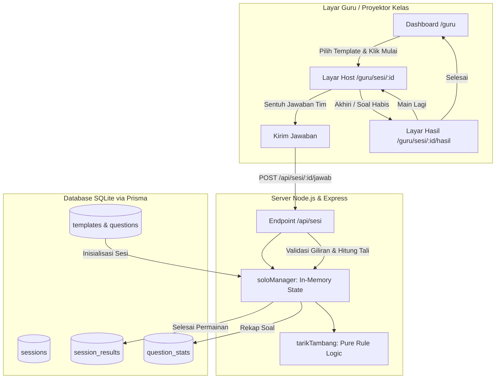
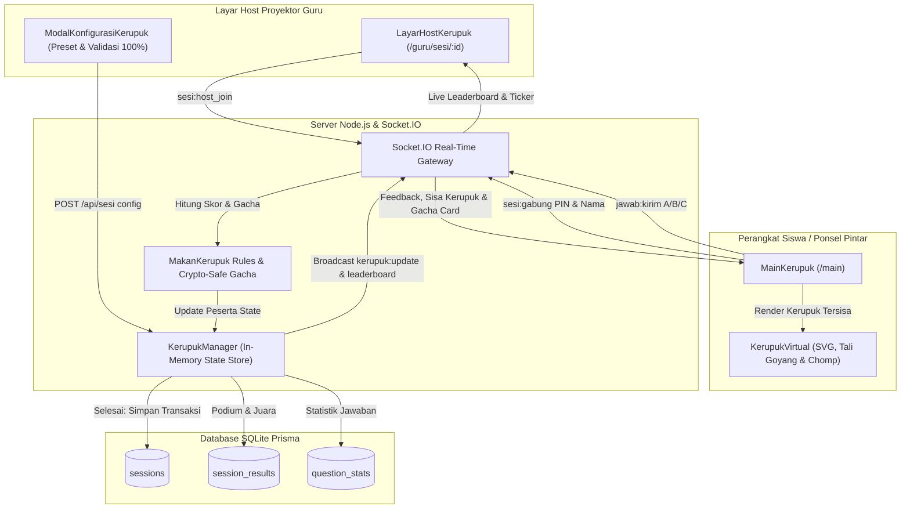
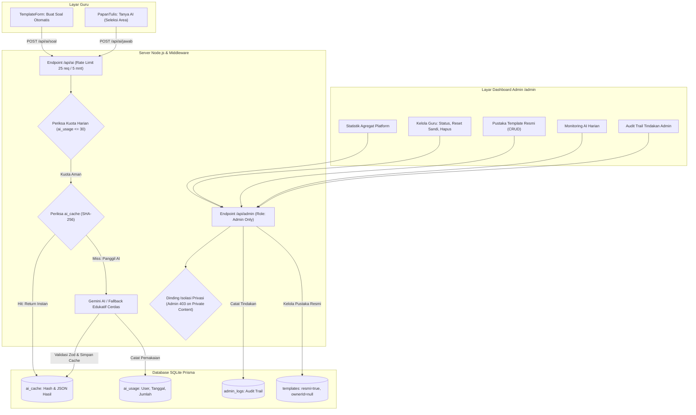

# Discere

Platform kelas interaktif untuk guru: papan tulis digital tak terbatas untuk materi pelajaran dan game lomba interaktif berbasis web. Dibuat untuk **LOGICODIX 2026 Hackathon Competition**, subtema **Smart & Fun Education**.

Tagline: *"Belajar seru, tarik kemenangan bersama."*

---

## Fitur Utama

- **Sistem Desain & Aksesibilitas Modern:**
  - Desain bertema 17 Agustusan ramah anak: Merah `#D7262E`, Kuning `#F5B700`, Biru `#1E2A5A`, dan Slate.
  - Tipografi lokal: font *Baloo 2* untuk judul dan *Inter* untuk teks isi via `@fontsource` (tanpa CDN eksternal).
  - Dukungan mode gelap otomatis (`prefers-color-scheme`) dan pengurangan gerak (`prefers-reduced-motion`).
  - Komponen antarmuka modular: Button, Card, Input, Modal, Badge, dan Toast dengan ikon `lucide-react`.
- **Halaman Publik Modern & Terpadu (Single-Page Experience):**
  - **Beranda Terpadu (`/`):** Desain halaman satu pintu dengan navigasi halus ke bagian Hero, Apa itu Discere, Fitur Unggulan (`/#fitur`), Template Soal, Cara Kerja (`/#cara`), Demo Interaktif, FAQ, dan Kebijakan Privasi UU PDP No. 27 Tahun 2022.
  - **Akses Siswa Cepat (`/main` & `/join`):** Desain mobile-first bertema papan tulis interaktif, memungkinkan siswa bergabung hanya dengan memasukkan 6 digit PIN sesi dan nama panggilan tanpa registrasi akun.
  - **Pendaftaran & Masuk Guru (`/daftar` & `/masuk`):** Autentikasi aman JWT dengan cookie `httpOnly`, validasi input ganda (Zod di klien dan server), serta pembatasan laju (*rate limiting*).
- **Dashboard Guru & Manajemen Template:**
  - **Ringkasan Aktivitas (`/guru`):** Kartu metrik jumlah template, sesi tuntas, dan papan tersimpan, dilengkapi daftar template terbaru dan sesi terakhir.
  - **Koleksi & Pustaka Resmi:** Pengelolaan template kuis (CRUD), duplikasi template pustaka resmi admin ke koleksi guru, dan pencarian instan.
  - **Form Pembuat Template (`/guru/template/baru` & `/guru/template/:id/ubah`):** Form pembuatan soal dinamis dengan 3 pilihan jawaban (A, B, C), penentuan kunci jawaban, dan penjelasan materi opsional.
- **Game Solo Tarik Tambang (Layar Bersama):**
  - **Arena Proyektor Kelas (`/guru/sesi/:id`):** Dioptimalkan untuk satu layar proyektor bersama di kelas tanpa membutuhkan HP siswa, token, atau QR code.
  - **Visualisasi Tali Interaktif:** Arena tali berskala `-8` hingga `+8` dengan penanda bendera beranimasi halus, indikator giliran aktif (Merah/Putih), dan tombol pilihan jawaban berukuran besar.
  - **Logika Permainan Terpusat di Server:** Perhitungan pergerakan tali murni di server (jawaban benar menggeser tali 1 langkah ke arah tim penjawab, salah tidak mengubah posisi).
  - **Kontrol Penuh Guru:** Kemudahan memulai, menjeda (`PAUSED`), melanjutkan (`PLAYING`), dan mengakhiri sesi dengan konfirmasi aman.
- **Game Multiplayer Tarik Tambang (HP Siswa & Real-time Socket.IO):**
  - **Siswa Bergabung Tanpa Akun (`/main`):** Siswa cukup memindai QR Code atau mengetik 6-digit kode PIN sesi dan nama panggilan langsung dari ponsel pintar tanpa registrasi.
  - **Pembagian Tim Adil & Seimbang:** Algoritma Fisher-Yates mengacak dan membagi siswa ke dalam Tim Merah dan Tim Putih secara otomatis dengan selisih jumlah anggota maksimal 1 (`diff <= 1`).
  - **Sinkronisasi Real-Time Dua Arah:** Dibangun di atas protokol Socket.IO dengan state manager in-memory (`multiManager`), menyiarkan pergerakan tali atomik, jawaban siswa, dan skor tim secara instan.
  - **Timer Server Otoritatif 15 Detik:** Menghindari kecurangan perangkat dengan mengontrol hitung mundur dan penutupan soal secara terpusat di server backend.
  - **Layar Host Proyektor Interaktif:** Menampilkan kode PIN raksasa yang terbaca dari baris belakang kelas, QR code jelas, daftar peserta live, visualisasi tali gerak mulus, dan kartu skor live.
  - **Privasi Terjamin:** Sesuai prinsip *privacy by design*, nama siswa hanya ada di memori RAM server selama sesi berlangsung dan tidak pernah disimpan permanen ke database SQLite.
  - **Dukungan Reconnect Tangguh:** Pemain yang terputus atau me-refresh peramban dapat langsung bergabung kembali ke tim dan soal aktifnya melalui kredensial sesi lokal (`sessionStorage`).
- **Game Multiplayer Makan Kerupuk Challenge (Individu 17 Agustus):**
  - **Konsep Permainan Tradisional Digital:** Setiap siswa mendapatkan 1 kerupuk virtual (kondisi awal 100%) yang tergantung pada tali rafia. Siswa menjawab soal kuis dan setiap jawaban benar memberikan kesempatan menggigit kerupuk virtual.
  - **Sistem Gacha Keberuntungan di Backend (Crypto-Safe):** Besaran gigitan ditentukan secara acak murni di server menggunakan `crypto.randomInt` berdasarkan konfigurasi probabilitas guru:
    - *Gigitan Besar:* Kerupuk berkurang 40%, Skor +40 pt
    - *Gigitan Sedang:* Kerupuk berkurang 25%, Skor +25 pt
    - *Gigitan Kecil:* Kerupuk berkurang 10%, Skor +10 pt
    - *Gigitan Sangat Kecil:* Kerupuk berkurang 5%, Skor +5 pt
    - *Tidak Kena (Zonk):* Kerupuk berkurang 0%, Skor +0 pt
  - **Sistem Skoring Adil & Bertingkat:** Jawaban benar memberikan poin dasar +100 pt, bonus streak +50 pt setiap kelipatan 3 jawaban benar (3, 6, 9, dst.), dan bonus penyelesaian +100 pt saat kerupuk pertama kali habis (0%).
  - **Aturan Batas Kerupuk:** Kerupuk tersisa di-clamp pada batas minimum 0% (tidak pernah minus).
  - **Leaderboard 4 Kriteria Penentu Urutan:**
    1. Total Skor Tertinggi
    2. Jumlah Jawaban Benar Terbanyak
    3. Persentase Kerupuk Tersisa Paling Sedikit
    4. Waktu Penyelesaian Paling Cepat
  - **Fleksibilitas Konfigurasi Guru:** Guru dapat memilih preset resmi (Normal: 15/25/35/20/5, Mudah: 35/30/20/12/3, Sulit: 5/15/30/35/15) atau mengatur slider kustom dengan validasi ketat total tepat 100%. Dilengkapi opsi kapasitas peserta (10-100), durasi per soal (10-30 detik), dan izin siswa susulan (*late join*).
  - **Layar Host Proyektor & Visual Siswa Mobile:** Menampilkan animasi interaktif kerupuk bergoyang, efek remahan renyah, sound effects Web Audio API (*crunch* dan *zonk*), live activity feed, serta podium juara 1, 2, 3 dengan rekapitulasi poin kelas lengkap.
- **Hasil Pertandingan & Evaluasi Materi Guru:**
  - **Layar Hasil (`/guru/sesi/:id/hasil`):** Banner perayaan pemenang (Merah, Putih, atau Seri), skor akhir, log perjalanan soal, dan tombol *Main Lagi* (membuat sesi baru dari template sama dengan kondisi awal bersih).
  - **Riwayat & Analisis Kelemahan Siswa:** Penyimpanan otomatis ke basis data via transaksi Prisma, dilengkapi modal detail evaluasi yang menyorot **soal yang paling sering dijawab salah** agar guru mengetahui topik yang perlu dibahas ulang.
- **Papan Tulis Digital Interaktif & Kolaborasi (Fabric.js & Socket.IO):**
  - **Kanvas Interaktif Tak Terbatas (`/papan/:id`):** Kanvas berbasis Fabric.js dengan dukungan pan & zoom (Alt/Space + geser atau roda tetikus), pena gambar bebas, penghapus objek instan, penambahan teks, bentuk bangun datar (persegi, lingkaran, segitiga, garis lurus, panah penunjuk), serta fitur unggah gambar materi.
  - **Kalkulator Melayang Interaktif (Prioritas P1):** Widget kalkulator melayang yang dapat digeser bebas (*draggable*) di atas kanvas dengan riwayat kalkulasi, operasi aritmetika lengkap, dukungan keyboard numerik, serta tampilan Baloo/Inter ramah anak.
  - **Ekspor Catatan Kanvas ke PNG (Prioritas P2):** Guru dapat langsung mengunduh hasil coretan materi berkualitas tinggi (*multiplier 2x*) berformat PNG untuk dibagikan ke siswa sebagai bahan rangkuman pelajaran.
  - **Kontrol Zoom Presisi & Reset Cepat:** Widget kontrol di pojok kanan bawah kanvas yang menampilkan persentase pembesaran aktif (*zoom percentage*), tombol perbesar/perkecil instan, dan satu tombol reset ke 100%.
  - **Penyesuaian Gaya & Riwayat Lengkap:** Palet warna tematik Discere, pengaturan ketebalan goresan (2px, 4px, 8px, 14px), warna isian bentuk transparan/solid, transparansi objek (opacity slider 10%-100%), pemformatan teks tebal/miring, dan riwayat Undo/Redo tak terbatas (hingga 40 langkah).
  - **Autosave Pintar & Pemulihan Sesi:** Penyimpanan otomatis dengan mekanisme debounce 1.5 detik ke database SQLite via Prisma ORM, indikator status live (*Menyimpan*, *Tersimpan*, *Gagal/Offline*), dan pemulihan seluruh objek kanvas secara utuh saat peramban dimuat ulang.
  - **Integrasi Sidebar Game Tarik Tambang:** Menu laci samping pada kanvas yang memungkinkan guru membuka koleksi template soal, memilih mode (Solo Layar Bersama atau Multiplayer HP Siswa), dan langsung meluncurkan game kelas tanpa merusak atau mereset objek di kanvas.
  - **Kolaborasi Multi-Pengguna Real-Time (`/b/:token`):** Guru dapat membagikan tautan ruang papan tulis ke siswa atau rekan pengajar dengan 2 tingkat izin:
    - **Viewer (Hanya Baca):** Siswa melihat goresan dan anotasi guru secara live tanpa risiko merusak kanvas (keamanan digembok di level gateway server & HTTP).
    - **Editor (Bisa Menggambar):** Kolaborator dapat bersama-sama menggambar materi dan menyiarkan objek baru secara instan.
    - **Pencabutan Akses Real-Time:** Pemilik papan dapat mencabut tautan berbagi kapan saja; server seketika menonaktifkan token dan memutuskan hak akses peserta terkait secara real-time.
- **Efek Suara Prosedural Web Audio API (Nuansa Lomba 17-an):**
  - **100% Offline Tanpa Aset Eksternal:** Seluruh suara disintesis langsung menggunakan Web Audio API murni (tanpa file mp3 eksternal), menjamin kecepatan instan tanpa beban unduhan atau masalah CORS.
  - **Efek Suara Edukatif & Meriah:** Meliputi peluit wasit pembuka lomba, efek gesekan tarikan tali, denting nada mayor jawaban benar, nada dengung bersahabat jawaban salah, dan melodi fanfare selebrasi juara tarik tambang.
  - **Kontrol Audio Guru:** Dilengkapi tombol beralih suara (*mute/unmute*) dengan persistensi status lokal di layar host proyektor kelas.
- **Fitur AI Terstruktur & Etis (Gemini & Fallback Cerdas):**
  - **Generator Soal dari Materi (`POST /api/ai/soal`):** Guru cukup menempelkan teks materi, memilih jumlah soal (5-15), dan jenjang (SD/SMP). AI menyusun soal pilihan ganda berstruktur Zod (3 pilihan opsi, 1 jawaban benar, penjelasan). Soal ditandai badge *"Dibuat AI"* dan wajib ditinjau guru sebelum disimpan.
  - **Tanya AI Papan Tulis (`POST /api/ai/jawab`):** Guru melingkari area soal/rumus di kanvas dan mengajukan pertanyaan. AI menganalisis potongan gambar kanvas dan menyajikan kartu solusi terstruktur (*Jawaban, Rumus, Langkah*) langsung di samping soal kanvas dalam teks polos tanpa markdown/LaTeX.
  - **Caching Cerdas SHA-256 (`ai_cache`):** Permintaan identik dilayani secara instan dari cache database untuk menghemat kuota dan mempercepat respon.
  - **Batas Pemakaian Harian (`ai_usage`):** Kuota 30 request per hari per guru dengan rate limiting `express-rate-limit` untuk mencegah penyalahgunaan.
  - **Kepatuhan Privasi Data:** Peringatan etika dan privasi sesuai UU PDP No. 27 Tahun 2022 agar guru tidak memasukkan nama atau data pribadi siswa.
- **Dashboard Administrator Platform (`/admin`):**
  - **Statistik Agregat:** Ringkasan metrik total guru, template, sesi, papan, dan grafik aktivitas 7 hari terakhir tanpa akses ke isi dokumen guru.
  - **Kelola Akun Guru:** Pencarian akun, aktivasi, nonaktivasi akun yang melanggar, reset kata sandi, dan penghapusan akun berantai (*cascade delete*).
  - **Pustaka Template Resmi:** Pembuatan, pengubahan, dan penghapusan template contoh resmi platform yang dapat disalin oleh seluruh guru.
  - **Monitoring AI:** Rekapitulasi pemakaian AI agregat harian dan jumlah cache tersimpan.
  - **Audit Trail Akuntabilitas (`admin_logs`):** Seluruh tindakan admin tercatat secara permanen (siapa mengubah apa dan kapan) untuk mengawasi pengelola platform.
  - **Jaminan Isolasi Privasi Guru & Siswa:** Administrator secara tegas dilarang membuka atau mengintip isi papan tulis privat guru, template privat, hasil kuis guru, maupun data siswa (akses diblokir di level middleware server dengan status `403 Forbidden`).
- **Autentikasi & Keamanan:**
  - Pendaftaran guru (`/daftar`) dan Masuk (`/masuk`) divalidasi ganda dengan Zod (sisi klien dan server).
  - Sesi JWT aman tersimpan di cookie `httpOnly` dengan perlindungan rate limit `express-rate-limit`.
  - Proteksi rute otomatis: pengunjung belum login diarahkan ke `/masuk`, guru diarahkan ke `/guru`, dan admin diarahkan ke `/admin`.
- **Database & Data Awal:**
  - Basis data SQLite lokal berbasis Prisma ORM 7 dengan adapter driver `better-sqlite3`.
  - Skrip seed idempoten dengan akun demo guru, administrator, serta 5 template soal siap pakai.

---

## Cara Menjalankan

### Kebutuhan Sistem
- Node.js LTS (v22+)
- npm (v10+)

### Instalasi dan Konfigurasi
1. **Pasang dependensi:**
   ```bash
   npm install
   ```
2. **Siapkan konfigurasi lingkungan:**
   Salin `.env.example` ke `.env` lalu sesuaikan nilai rahasia (seperti `JWT_SECRET` dan kata sandi akun seed):
   ```bash
   cp .env.example .env
   ```
3. **Migrasi Database:**
   Jalankan migrasi Prisma untuk menyiapkan skema database SQLite lokal:
   ```bash
   npm run db:migrate
   ```
4. **Isi Data Awal (Seed):**
   Jalankan seed untuk membuat akun demo dan template contoh:
   ```bash
   npm run db:seed
   ```

### Menjalankan Aplikasi
- **Mode Pengembangan (Hot Reload Client + Server):**
  ```bash
  npm run dev
  ```
  Akses di peramban: `http://localhost:5173` (client) dan `http://localhost:3000` (server API).

- **Mode Produksi (Single Process Melayani API + Client Dist):**
  ```bash
  npm run build
  npm start
  ```
  Server akan melayani aplikasi di `http://localhost:3000` dan mencetak alamat IP jaringan lokal agar siswa dapat bergabung dari perangkat lain di WiFi yang sama.

### Akun Demo Bawaan
Setelah menjalankan `npm run db:seed`, akun berikut siap digunakan:

| Peran | Email | Kata Sandi Bawaan | Keterangan |
| :--- | :--- | :--- | :--- |
| **Administrator** | `admin@discere.local` | `AdminDiscere2026!` | Pengelola platform & template resmi |
| **Guru Demo** | `guru@discere.local` | `GuruDiscere2026!` | Memiliki template "Pecahan Kelas 5" & "Sejarah Proklamasi" |

---

## Diagram Arsitektur Game Solo



---

## Diagram Arsitektur Game Multiplayer (Socket.IO)

```mermaid
flowchart TD
    subgraph Host_Guru [Layar Host Guru / Proyektor Kelas]
        HOST_LOBBY["Layar Lobi PIN & QR Code"] -->|sesi:mulai| SVR_SOCKET
        HOST_GAME["Layar Arena Proyektor"] <--|"tali:update & soal:tampil"| SVR_SOCKET
        HOST_GAME -->|sesi:akhiri_manual| SVR_SOCKET
    end

    subgraph Klien_Siswa [HP Siswa Masing-Masing /main]
        SISWA_JOIN["Form PIN & Nama"] -->|sesi:gabung| SVR_SOCKET
        SISWA_GAME["Layar Soal & Tombol A/B/C"] <--|"teams_assigned & soal:tampil"| SVR_SOCKET
        SISWA_GAME -->|jawab:kirim| SVR_SOCKET
        SISWA_RESULT["Layar Hasil Tim"] <--|sesi:selesai| SVR_SOCKET
    end

    subgraph Backend_Socket [Server Real-Time Socket.IO]
        SVR_SOCKET((Socket.IO Gateway))
        MULTI_MGR["multiManager: In-Memory Game State"]
        TIMER_SRV["Timer Otoritatif 15 Detik"]
        LOGIC_TARIK["tarikTambang: Pure Rule Logic"]
        SVR_SOCKET <--> MULTI_MGR
        MULTI_MGR --> TIMER_SRV
        MULTI_MGR --> LOGIC_TARIK
    end

    subgraph Penyimpanan_Data [Database SQLite Prisma]
        DB_SESS[(sessions)]
        DB_RES[(session_results)]
        DB_STAT[(question_stats)]
        MULTI_MGR -->|Selesai: Transaksi DB| DB_SESS
        MULTI_MGR -->|Skor & Pemenang| DB_RES
        MULTI_MGR -->|Statistik Agregat Per Soal| DB_STAT
    end
```

---

## Diagram Arsitektur Game Makan Kerupuk Challenge



---

## Diagram Arsitektur Papan Tulis & Kolaborasi Real-Time

```mermaid
flowchart TD
    subgraph Pengguna_Papan [Ruang Kolaborasi Kelas]
        GURU["Guru (Pemilik Papan) /papan/:id"]
        EDITOR["Rekan / Siswa Editor /b/:token"]
        VIEWER["Siswa Penonton /b/:token (Read-Only)"]
    end

    subgraph Fabric_Kanvas [Fabric.js Engine di Peramban]
        CANVAS["Canvas: Pan, Zoom, Gambar, Bentuk, Teks, Gambar Upload"]
        AUTOSAVE["Debounced Autosave (1.5 Detik)"]
        SIDEBAR["Drawer Template Game (Solo & Multi)"]
        UNDO_REDO["Undo / Redo Stack (40 Aksi)"]
        CANVAS <--> UNDO_REDO
        CANVAS --> AUTOSAVE
        CANVAS <--> SIDEBAR
    end

    subgraph Server_Kolaborasi [Server Node.js & Socket.IO Gateway]
        BOARD_GATEWAY((Socket.IO: boardRooms))
        PERM_CHECK{"Validasi Hak Akses (Owner / Editor / Viewer)"}
        REST_PAPAN["REST API /api/papan & /api/papan/share"]
        BOARD_GATEWAY --> PERM_CHECK
        PERM_CHECK -->|Izin Sah| BROADCAST["Siarkan Objek ke Rekan (papan:ubah)"]
        PERM_CHECK -->|Viewer Kirim Objek| REJECT["Tolak Transaksi (403 / Error Socket)"]
    end

    subgraph Database_Papan [Database SQLite Prisma]
        TBL_BOARD[(boards: Data Kanvas JSON)]
        TBL_SHARE[(board_shares: Token & Peran)]
    end

    GURU <-->|Interaksi Penuh + Kontrol Bagikan| CANVAS
    EDITOR <-->|Menggambar Bersama| CANVAS
    VIEWER <--|Menyimak Live Tanpa Alat Modifikasi| CANVAS

    AUTOSAVE -->|PUT /api/papan/:id atau /api/papan/share/:token| REST_PAPAN
    REST_PAPAN -->|Penyimpanan Terjadwal| TBL_BOARD
    REST_PAPAN -->|Pembuatan & Pencabutan Token| TBL_SHARE

    GURU <-->|papan:gabung & papan:ubah| BOARD_GATEWAY
    EDITOR <-->|papan:gabung & papan:ubah| BOARD_GATEWAY
    VIEWER <--|papan:gabung & pembaruan live| BOARD_GATEWAY

    SIDEBAR -->|Luncurkan Sesi Tanpa Hilang Kanvas| GAME_MODAL["Game Solo / Multiplayer Sesi"]
```

---

## Diagram Arsitektur Fitur AI & Administrasi Platform



---

## Pengujian Otomatis (Testing Suite)

Untuk menjalankan pengujian otomatis di seluruh modul platform:

```bash
# 1. Pastikan server lokal aktif di terminal terpisah
npm start

# 2. Uji Komprehensif Seluruh Modul Sekaligus (Tahap 1 - 9)
npx tsx tests/test-full-suite.ts

# 3. Uji Spesifik per Modul
npx tsx tests/test-solo.ts         # Game Solo Tarik Tambang
npx tsx tests/test-e2e-multi.ts     # Game Multiplayer Socket.IO
npx tsx tests/test-e2e-papan.ts     # Papan Tulis Fabric.js & Kolaborasi
npx tsx tests/test-e2e-ai-admin.ts  # Fitur AI, Caching, Kuota, & Dashboard Admin
```

---

## Skenario Video Demo (3-5 Menit Tanpa Suara Narasi)

Sesuai aturan kompetisi LOGICODIX 2026, rekaman video demonstrasi berdurasi 3 hingga 5 menit tanpa narasi suara (dilengkapi teks keterangan singkat di layar):

| Menit | Adegan | Aksi Antarmuka | Keterangan Teks di Layar (Caption) |
| :---: | :--- | :--- | :--- |
| **00:00 - 00:35** | **Beranda & Login Guru** | Buka `http://localhost:3000/`, gulir sekilas ke Hero, Masalah, & Fitur. Klik **Masuk**, masukkan akun demo `guru@discere.local`. | *"Discere: Papan Tulis Interaktif & Game Lomba Edukatif 17-an"*<br>*"Login cepat guru dan dashboard ringkasan materi"* |
| **00:35 - 01:15** | **Pembuat Soal Otomatis dengan AI** | Masuk ke menu **Template Baru**, klik **Buat Soal dengan AI**. Tempel materi ekosistem, pilih 5 soal SD. Tinjau soal berlabel *"Dibuat AI"*, lalu simpan. | *"Generator Soal AI dari teks materi (tervalidasi Zod)"*<br>*"Guru meninjau & mengedit sebelum disimpan"* |
| **01:15 - 02:15** | **Papan Tulis Digital & Tanya AI** | Buka Papan Tulis. Tulis materi/rumus menggunakan pena, buat bentuk geometri, buka **Kalkulator Melayang**, lalu gunakan tool **Tanya AI** melingkari soal di kanvas. Muncul kartu solusi. Klik **Unduh Gambar (PNG)**. | *"Kanvas tak terbatas Fabric.js, autosave & kalkulator melayang"*<br>*"Tanya AI: Lingkari soal untuk solusi langkah demi langkah"*<br>*"Ekspor catatan PNG instan untuk siswa"* |
| **02:15 - 03:00** | **Lomba Tarik Tambang Mode Solo** | Buka drawer **Template Game** di papan tulis, pilih Mode Solo. Tampil proyektor kelas tarik tambang. Sentuh jawaban Tim Merah & Tim Putih secara bergantian. Tali bergeser dengan efek suara. Selesai dan lihat layar hasil. | *"Mode Solo: 1 proyektor bersama di kelas tanpa butuh HP"*<br>*"Jawaban benar menggeser tali secara real-time"* |
| **03:00 - 04:00** | **Lomba Tarik Tambang Multiplayer** | Luncurkan template dengan Mode Multiplayer. Layar host menampilkan PIN & QR code. Buka 2 tab/jendela baru di `/main`, masukkan PIN dan nama siswa. Guru klik **Mulai Lomba**. Siswa menjawab dari HP. Tali bergerak live via Socket.IO. Layar selebrasi juara. | *"Mode Multiplayer: Siswa bergabung dengan PIN tanpa akun"*<br>*"Pembagian tim seimbang otomatis & sinkronisasi Socket.IO"*<br>*"Privasi aman: nama siswa tidak dicatat ke database"* |
| **04:00 - 04:30** | **Dashboard Admin & Isolasi Privasi** | Keluar, login akun `admin@discere.local`. Tunjukkan statistik agregat platform, manajemen akun guru, audit trail log, dan penegasan isolasi privasi (admin diblokir 403 mengintip papan guru). | *"Dashboard Admin: Pengawasan platform transparan"*<br>*"Isolasi privasi mutlak: admin tidak bisa mengintip dokumen guru"* |

---

## Panduan Evaluasi Grand Final (Localhost Verification)

Platform Discere dirancang untuk keandalan maksimal saat demonstrasi langsung di hadapan juri:
1. **Jalankan Aplikasi:**
   ```bash
   npm run build
   npm start
   ```
2. **Koneksi Jaringan Kelas:**
   - Server mencetak IP LAN lokal (misal: `http://192.168.1.10:3000`).
   - Guru membuka proyektor di laptop (`localhost:3000`).
   - Siswa menyambung ke WiFi yang sama dan membuka alamat IP tersebut dari ponsel tanpa instalasi aplikasi.
3. **Mitigasi Kondisi Darurat (Offline / Tanpa WiFi):**
   - Jika jaringan WiFi tempat lomba mati atau tidak stabil, guru dapat beralih ke **Mode Solo** (satu layar laptop/proyektor bersama).
   - Seluruh kanvas, kalkulator melayang, visualisasi tali tarik tambang, dan suara Web Audio API tetap berjalan 100% normal tanpa membutuhkan internet.

---

## Penggunaan AI

Sesuai ketentuan transparansi kompetisi LOGICODIX 2026:
1. **AI sebagai Alat Bantu Pengembangan (AI Coding Assistant):**
   - Agen AI digunakan sebagai mitra *pair programming* untuk merancang arsitektur modular, menulis logika murni perhitungan tali tarik tambang ([tarikTambang.ts](file:///c:/DIscere/server/src/games/tarikTambang.ts)), mengimplementasikan visualisasi komponen interaktif Tailwind CSS, serta menyusun skrip pengujian otomatis (unit testing & end-to-end integration test).
   - Seluruh kode divalidasi dengan pengujian ketat, audit keamanan otentikasi/otorisasi, dan verifikasi tipe TypeScript (`strict: true`).
2. **AI sebagai Fitur Aplikasi:**
   - **Pembuat Soal dari Teks Materi (`POST /api/ai/soal`):** Guru menginput materi, AI merespons dalam JSON terstruktur yang divalidasi dengan skema Zod (tepat 3 pilihan jawaban, 1 kunci jawaban, dan penjelasan materi).
   - **Tanya AI Papan Tulis (`POST /api/ai/jawab`):** Guru melingkari soal/rumus di kanvas Fabric.js, potongan gambar dianalisis untuk menghasilkan kartu solusi terstruktur (*Jawaban, Rumus, Langkah*) dalam teks polos tanpa markdown atau LaTeX.
   - **Caching Cerdas & Kuota Harian:** Setiap input di-hash dengan algoritma SHA-256 dan disimpan di tabel `ai_cache` agar tidak memanggil AI berulang kali untuk materi yang sama. Penggunaan dibatasi secara aman pada 30 permintaan per guru per hari melalui tabel `ai_usage` dan rate limiter Express.
   - **Pemberitahuan Etika & Privasi:** Sesuai prinsip UU PDP No. 27 Tahun 2022, data siswa dilarang keras diikutsertakan dalam materi prompt AI, dan seluruh soal hasil AI wajib ditinjau serta dapat disunting oleh guru sebelum disimpan ke database.
