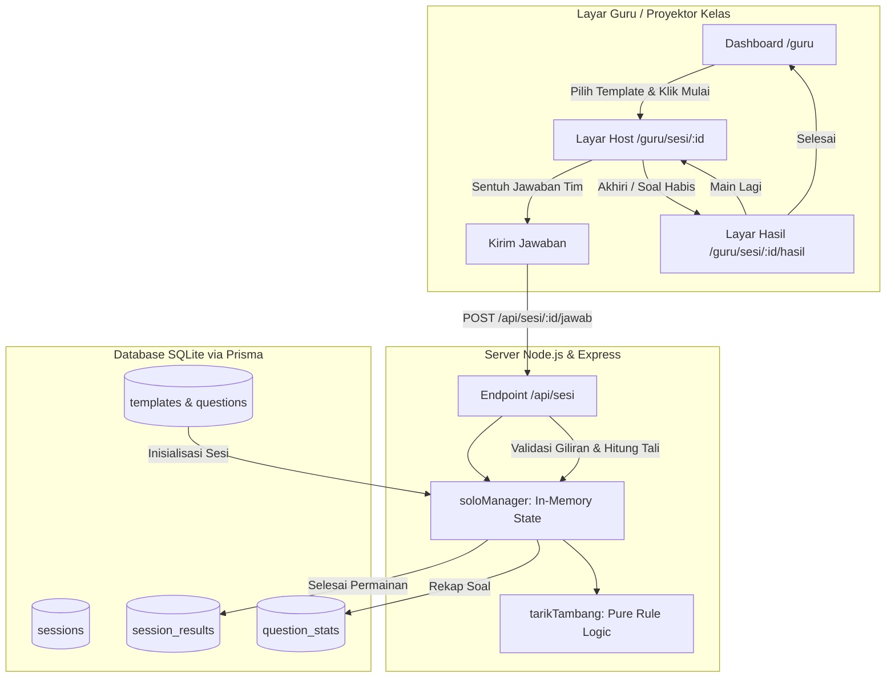

# Discere

Platform kelas interaktif untuk guru: papan tulis digital tak terbatas untuk materi pelajaran dan game lomba interaktif berbasis web. Dibuat untuk **LOGICODIX 2026 Hackathon Competition**, subtema **Smart & Fun Education**.

Tagline: *"Belajar seru, tarik kemenangan bersama."*

---

## Fitur Utama

- **Sistem Desain & Aksesibilitas Modern:**
  - Desain bertema 17 Agustusan ramah anak: Merah `#D7262E`, Kuning `#F5B700`, Biru `#1E2A5A`, dan Slate.
  - Tipografi lokal: font *Baloo 2* untuk judul dan *Inter* untuk teks isi via `@fontsource` (tanpa CDN eksternal).
  - Dukungan mode gelap otomatis (`prefers-color-scheme`) dan pengurangan gerak (`prefers-reduced-motion`).
  - Komponen antarmuka modular: Button, Card, Input, Modal, Badge, dan Toast dengan ikon `lucide-react`.
- **Halaman Publik Lengkap:**
  - **Beranda (`/`):** 7 bagian komprehensif (Hero dengan simulasi tarik tambang animasi SVG, Masalah, Cara Kerja 3 langkah, Fitur Unggulan, Kelebihan, FAQ, dan Call-to-Action).
  - **Fitur (`/fitur`):** Penjelasan detail papan tulis Fabric.js, lomba tarik tambang, 2 mode main, asisten AI, kolaborasi, dan rekapitulasi evaluasi.
  - **Kelebihan (`/kelebihan`):** Keunggulan siswa tanpa akun, jalan di kelas tanpa HP, hemat sumber daya lokal, dan jaminan privasi data.
  - **Dokumentasi (`/dokumentasi`):** Panduan langkah demi langkah guru di kelas beserta tanya jawab teknis jaringan lokal.
  - **Kebijakan Privasi (`/privasi`):** Transparansi data sesuai UU PDP No. 27 Tahun 2022, penegasan bahwa nama siswa tidak disimpan ke database, dan isolasi akses admin.
- **Dashboard Guru & Manajemen Template:**
  - **Ringkasan Aktivitas (`/guru`):** Kartu metrik jumlah template, sesi tuntas, dan papan tersimpan, dilengkapi daftar template terbaru dan sesi terakhir.
  - **Koleksi & Pustaka Resmi:** Pengelolaan template kuis (CRUD), duplikasi template pustaka resmi admin ke koleksi guru, dan pencarian instan.
  - **Form Pembuat Template (`/guru/template/baru` & `/guru/template/:id/ubah`):** Form pembuatan soal dinamis dengan 3 pilihan jawaban (A, B, C), penentuan kunci jawaban, dan penjelasan materi opsional.
- **Game Solo Tarik Tambang (Layar Bersama):**
  - **Arena Proyektor Kelas (`/guru/sesi/:id`):** Dioptimalkan untuk satu layar proyektor bersama di kelas tanpa membutuhkan HP siswa, token, atau QR code.
  - **Visualisasi Tali Interaktif:** Arena tali berskala `-8` hingga `+8` dengan penanda bendera beranimasi halus, indikator giliran aktif (Merah/Putih), dan tombol pilihan jawaban berukuran besar.
  - **Logika Permainan Terpusat di Server:** Perhitungan pergerakan tali murni di server (jawaban benar menggeser tali 1 langkah ke arah tim penjawab, salah tidak mengubah posisi).
  - **Kontrol Penuh Guru:** Kemudahan memulai, menjeda (`PAUSED`), melanjutkan (`PLAYING`), dan mengakhiri sesi dengan konfirmasi aman.
- **Hasil Pertandingan & Evaluasi Materi Guru:**
  - **Layar Hasil (`/guru/sesi/:id/hasil`):** Banner perayaan pemenang (Merah, Putih, atau Seri), skor akhir, log perjalanan soal, dan tombol *Main Lagi* (membuat sesi baru dari template sama dengan kondisi awal bersih).
  - **Riwayat & Analisis Kelemahan Siswa:** Penyimpanan otomatis ke basis data via transaksi Prisma, dilengkapi modal detail evaluasi yang menyorot **soal yang paling sering dijawab salah** agar guru mengetahui topik yang perlu dibahas ulang.
- **Autentikasi & Keamanan:**
  - Pendaftaran guru (`/daftar`) dan Masuk (`/masuk`) divalidasi ganda dengan Zod (sisi klien dan server).
  - Sesi JWT aman tersimpan di cookie `httpOnly` dengan perlindungan rate limit `express-rate-limit`.
  - Proteksi rute otomatis: pengunjung belum login diarahkan ke `/masuk`, guru diarahkan ke `/guru`, dan admin diarahkan ke `/admin`.
- **Database & Data Awal:**
  - Basis data SQLite lokal berbasis Prisma ORM 7 dengan adapter driver `better-sqlite3`.
  - Skrip seed idempoten dengan akun demo guru, administrator, serta 5 template soal siap pakai.

---

## Cara Menjalankan

### Kebutuhan Sistem
- Node.js LTS (v22+)
- npm (v10+)

### Instalasi dan Konfigurasi
1. **Pasang dependensi:**
   ```bash
   npm install
   ```
2. **Siapkan konfigurasi lingkungan:**
   Salin `.env.example` ke `.env` lalu sesuaikan nilai rahasia (seperti `JWT_SECRET` dan kata sandi akun seed):
   ```bash
   cp .env.example .env
   ```
3. **Migrasi Database:**
   Jalankan migrasi Prisma untuk menyiapkan skema database SQLite lokal:
   ```bash
   npm run db:migrate
   ```
4. **Isi Data Awal (Seed):**
   Jalankan seed untuk membuat akun demo dan template contoh:
   ```bash
   npm run db:seed
   ```

### Menjalankan Aplikasi
- **Mode Pengembangan (Hot Reload Client + Server):**
  ```bash
  npm run dev
  ```
  Akses di peramban: `http://localhost:5173` (client) dan `http://localhost:3000` (server API).

- **Mode Produksi (Single Process Melayani API + Client Dist):**
  ```bash
  npm run build
  npm start
  ```
  Server akan melayani aplikasi di `http://localhost:3000` dan mencetak alamat IP jaringan lokal agar siswa dapat bergabung dari perangkat lain di WiFi yang sama.

### Akun Demo Bawaan
Setelah menjalankan `npm run db:seed`, akun berikut siap digunakan:

| Peran | Email | Kata Sandi Bawaan | Keterangan |
| :--- | :--- | :--- | :--- |
| **Administrator** | `admin@discere.local` | `AdminDiscere2026!` | Pengelola platform & template resmi |
| **Guru Demo** | `guru@discere.local` | `GuruDiscere2026!` | Memiliki template "Pecahan Kelas 5" & "Sejarah Proklamasi" |

---

## Diagram Arsitektur Game Solo



---

## Penggunaan AI

Sesuai ketentuan transparansi kompetisi LOGICODIX 2026:
1. **AI sebagai Alat Bantu Pengembangan (AI Coding Assistant):**
   - Agen AI digunakan sebagai mitra *pair programming* untuk merancang arsitektur modular, menulis logika murni perhitungan tali tarik tambang ([tarikTambang.ts](file:///c:/DIscere/server/src/games/tarikTambang.ts)), mengimplementasikan visualisasi komponen interaktif Tailwind CSS, serta menyusun skrip pengujian otomatis (unit testing & end-to-end integration test).
   - Seluruh kode divalidasi dengan pengujian ketat, audit keamanan otentikasi/otorisasi, dan verifikasi tipe TypeScript (`strict: true`).
2. **AI sebagai Fitur Aplikasi:**
   - Fitur AI di dalam aplikasi (seperti pembuatan soal otomatis dan asisten penjawab soal dari papan tulis) dikembangkan secara terisolasi pada backend pada tahap mendatang dengan integrasi model Gemini API dan validasi skema terstruktur Zod.
